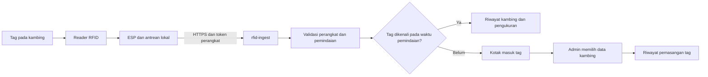

# Sahira Farm — alur admin, RFID, dan ESP

Halaman `/` adalah profil publik peternakan. Ruang kerja ada di `/admin`, editor halaman di `/admin/konten`, dan pengelolaan tag/perangkat di `/admin/rfid`. Akses akun ada di `/admin/akses`; tautannya tidak perlu ditampilkan pada halaman publik.

## Yang sudah disiapkan

- Data kambing, ras, silsilah, kandang, pertumbuhan, pakan, perlakuan, sensor, dan konten halaman menggunakan Supabase dengan pembatasan per pemilik. Nama tabel lama `sheep` dipertahankan agar relasi/data tetap kompatibel; antarmuka menggunakan istilah kambing.
- `rfid_tags` menyimpan identitas tag. `rfid_assignments` menyimpan riwayat pemasangan dan pelepasan. Satu kambing hanya boleh memiliki satu tag aktif, dan satu tag hanya boleh menempel pada satu kambing pada saat yang sama.
- `rfid_scans` menyimpan peristiwa asli dari pembaca, waktu perangkat, waktu penerimaan server, dan kaitan kambing pada saat dipindai. UID yang belum dikenal masuk kotak masuk; tidak membuat kambing secara otomatis.
- Setiap perangkat fisik memiliki kredensial sendiri. Token mentah hanya dikembalikan saat pendaftaran; database hanya menyimpan hash SHA-256 di schema `private`. Kunci `service_role` Supabase hanya digunakan Edge Function, tidak dipasang di ESP atau aplikasi browser.
- Penerimaan data dilakukan Edge Function `rfid-ingest` dan RPC database atomik. Mengirim ulang `event_id` yang sama dengan isi sama tidak menggandakan data. Isi berbeda dengan ID yang sama ditolak.



## Langkah awal yang perlu Anda lakukan

1. Buka `/admin/akses` dan gunakan alamat admin yang disetujui, `sahira.admin@sahirafarm.com`. Buat kata sandi sendiri dan selesaikan verifikasi email. Alamat itu harus merupakan kotak surat yang benar-benar dapat Anda akses. Akses admin diberikan melalui daftar email yang dikelola server; membuat akun biasa tidak otomatis memberi hak admin.
2. Isi konten profil Sahira Farm, kontak, foto peternakan, dan katalog ras melalui editor. Foto ilustrasi perlu diganti foto milik peternakan sebelum dipakai sebagai bukti kondisi/ternak yang ditawarkan.
3. Buat data kambing di monitoring: kode ternak yang terlihat manusia, nama, tanggal lahir, jenis kelamin, komposisi ras yang berjumlah 100%, kandang, dan riwayat terkait. Kode ternak seperti `SF-001` adalah identitas administrasi; UID RFID adalah identitas elektronik yang terpisah.
4. Catat model ESP, model reader, tipe/standar tag, antarmuka reader, catu daya, dan sensor timbangan yang akan digunakan. Komponen harus dipastikan cocok sebelum menentukan wiring dan firmware final.
5. Daftarkan perangkat di halaman RFID. Simpan `device_id` dan token yang tampil satu kali ke konfigurasi perangkat dengan aman. Jika token hilang atau bocor, cabut akses perangkat lama lalu daftarkan perangkat pengganti dengan identitas baru. Riwayat perangkat lama tetap tersimpan.
6. Uji satu reader dan satu tag, lalu lakukan alur pendaftaran di bawah sebelum memasang semua tag pada ternak.

Email admin harus dimasukkan operator server ke `private.admin_allowlist` dalam bentuk huruf kecil. RPC `claim_farm_admin()` memeriksa email di `auth.users` dan `email_confirmed_at`, bukan metadata yang dapat diubah pengguna. Setelah claim berhasil, hak admin disimpan pada `user_roles`. Menghapus alamat dari allowlist mencegah claim berikutnya tetapi tidak mencabut role yang sudah diberikan; pencabutan admin harus menghapus role admin dan menutup sesi terkait.

## Mendaftarkan kambing dengan tag baru

1. Buat rekaman kambing dahulu, atau siapkan kambing yang sudah ada.
2. Scan tag dengan perangkat yang telah didaftarkan. UID baru masuk sebagai **pending** di kotak masuk RFID. Sebagai alternatif, UID dapat dimasukkan manual jika dibaca secara pasti dari reader.
3. Pilih pemindaian tersebut, pilih kambing yang benar, lalu tautkan. Sistem memvalidasi kepemilikan, UID, status pemindaian, dan pasangan aktif dalam satu transaksi.
4. Scan sekali lagi. Pemindaian berikutnya akan berstatus **recognized** dan menunjuk kambing tersebut.
5. Untuk tag hilang/rusak, lepaskan pasangan lama disertai alasan, lalu tautkan tag pengganti. Pemindaian dan sejarah tag lama tidak dihapus.

UID dinormalisasi ke huruf besar dan pemisah spasi/titik dua/tanda hubung dihapus. Nol di depan dipertahankan. Contoh `04:00:ab:19` menjadi `0400AB19`. Gunakan representasi UID yang konsisten dari semua reader; jangan berganti antara representasi desimal dan heksadesimal tanpa aturan konversi perangkat yang jelas. Prefix seperti `0x` tidak diterima.

Pemindaian lama yang tadinya tidak dikenal tetap menyimpan `sheep_id = null` setelah ditindaklanjuti. Statusnya berubah menjadi **resolved**, dengan catatan siapa yang menyelesaikan. Ini sengaja menjaga fakta pada saat pemindaian. Satu tindakan penyelesaian berlaku untuk pemindaian yang dipilih; pemindaian pending lain dapat diabaikan dengan alasan. Data lama tidak otomatis diubah menjadi hasil pengukuran kambing. Status **ignored** mencatat pemindaian yang sengaja diabaikan.

## Kontrak ESP ke server

Endpoint:

```text
POST https://<project-ref>.supabase.co/functions/v1/rfid-ingest
Content-Type: application/json
Authorization: Bearer <token-perangkat-yang-diberikan-saat-pendaftaran>
```

Isi JSON contoh, dengan UUID perangkat asli dan waktu aktual saat perangkat mengirim:

```json
{
  "device_id": "11111111-1111-4111-8111-111111111111",
  "event_id": "22222222-2222-4222-8222-222222222222",
  "uid": "0400AB19",
  "observed_at": "2026-10-18T07:00:00.000Z",
  "firmware_version": "sahira-reader-1.0.0",
  "weight_kg": 42.5
}
```

`firmware_version` dan `weight_kg` opsional. RFID sendiri mengidentifikasi ternak; bobot hanya dikirim bila berasal dari timbangan/sensor yang sudah dikalibrasi dan pasti berhubungan dengan kambing yang sedang dibaca. Tinggi, kondisi kesehatan, genetik, dan kualitas ternak tidak dapat disimpulkan dari pembacaan RFID saja.

`event_id` adalah UUID unik untuk satu peristiwa, dibuat ketika scan dicatat dan disimpan bersama payload pada antrean lokal. Gunakan ID dan payload yang sama untuk pengiriman ulang. Jangan membuat ID baru pada setiap retry. `observed_at` wajib ISO 8601 dengan zona waktu; firmware harus menyinkronkan jam sebelum membuat pengukuran. Server menerima data maksimal 30 hari ke belakang dengan toleransi jam perangkat 5 menit ke depan. `received_at` diisi server.

Perangkat tidak mengirim `owner_id`, `sheep_id`, atau status; identitas pemilik ditentukan dari kredensial perangkat, lalu kambing ditentukan dari riwayat pemasangan tag pada `observed_at`. Input yang tidak dikenal ditolak. Maksimum body 8 KiB, maksimum 120 peristiwa baru per perangkat per menit, dan bobot lebih dari 0 sampai 250 kg. Batas bobot adalah validasi input aplikasi, bukan spesifikasi akurasi sensor.

| Respons | Tindakan firmware |
| --- | --- |
| `201` | Peristiwa baru diterima; hapus dari antrean lokal. |
| `200` dengan `duplicate: true` | Peristiwa sudah tersimpan; aman menghapus dari antrean. |
| `400` / `413` / `415` | Perbaiki payload, waktu, ukuran, atau Content-Type; simpan diagnostik lokal. |
| `401` | Periksa kredensial/perangkat dicabut; hentikan retry cepat. |
| `409` | ID peristiwa digunakan untuk isi berbeda; perbaiki pencatatan ID. |
| `429` | Tunggu sesuai `Retry-After` sebelum retry. |
| `503` / koneksi putus | Retry dengan ID dan isi yang sama, exponential backoff dan jitter. |

Gunakan HTTPS dengan verifikasi sertifikat; jangan mengaktifkan mode `setInsecure`. Firmware perlu menangani putus jaringan dengan antrean lokal yang dibatasi kapasitas, debounce pembacaan tag, dan mekanisme backoff. Reader dekat kandang dapat membaca tag berulang; tentukan batas satu peristiwa dengan alur operasional (misalnya satu penimbangan), bukan setiap loop pembacaan.

## Data yang masih perlu dipastikan sebelum firmware dan wiring

- Model ESP yang tepat dan versi framework/SDK.
- Model reader, dokumentasi pin dan tegangan logika, protokol komunikasi (UART/SPI/I2C/RS485 atau lainnya), dan kebutuhan catu daya.
- Standar/frekuensi tag yang benar-benar akan dipakai serta kemampuan reader untuk membacanya. Tag peternakan dan modul RFID hobi tidak selalu kompatibel.
- Bentuk output UID reader dan apakah ada country code/checksum/framing yang harus diparsing.
- Lokasi baca: pintu kandang, handheld, atau satu ternak di timbangan; jarak baca dan peluang beberapa tag terbaca bersamaan.
- Model sensor bobot, prosedur kalibrasi, jaringan/Wi-Fi, serta kebutuhan penanganan data offline.

Tanpa model komponen itu, pin/wiring dan firmware khusus belum ditetapkan. Kontrak server sudah dapat diuji dengan HTTP, tetapi kompatibilitas perangkat fisik dan akurasi timbangan tetap harus diuji di kandang.

Supabase mengumumkan penghentian sebagian cipher CBC TLS 1.2 paling awal 10 November 2026. Gunakan SDK ESP/TLS yang mendukung cipher modern seperti GCM; ini relevan untuk perangkat lama. Lihat [pengumuman resmi TLS](https://supabase.com/changelog/cbc-tls-ciphers-deprecated).

## Berkas teknis dan verifikasi

- `supabase/migrations/001_initial.sql` dan `002_consistency.sql`: data inti dan konsistensi riwayat.
- `supabase/migrations/20261018063031_rfid_device_ingestion.sql`: admin allowlist, tag, pasangan, scan, kredensial, RLS, RPC, dan hardening perangkat fisik.
- `supabase/functions/rfid-ingest/`: handler ingestion dan pengujiannya. `supabase/config.toml` menggunakan `verify_jwt = false` hanya untuk endpoint ini karena token perangkat diverifikasi handler/database.
- `supabase/tests/rfid-security.sql`: uji transaksi yang di-rollback untuk role admin, isolasi pemilik, collision tag, replay, riwayat, dan pencabutan perangkat. Jalankan pada database disposable/local.

```sh
deno check supabase/functions/rfid-ingest/index.ts
deno test supabase/functions/rfid-ingest/handler_test.ts
```

Migration dan skenario SQL diuji pada PostgreSQL lokal dengan stub auth/storage Supabase; Edge handler diuji tanpa perangkat fisik. Verifikasi remote Supabase dan uji ESP nyata merupakan pemeriksaan berbeda. Dokumentasi resmi: [keamanan Edge Functions](https://supabase.com/docs/guides/functions/auth), [Row Level Security](https://supabase.com/docs/guides/database/postgres/row-level-security).
